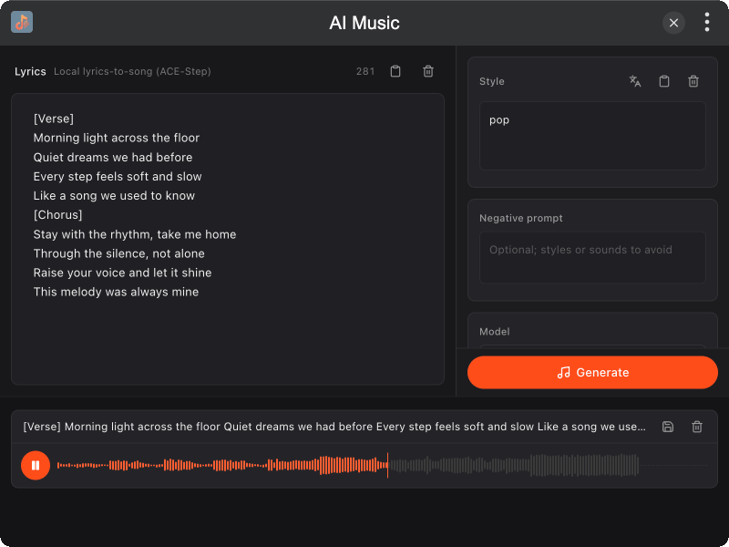

# tinker-ai-music

A local lyrics-to-song plugin for [TINKER](https://github.com/liriliri/tinker), powered by [audio.cpp](https://github.com/0xShug0/audio.cpp) via `audiocpp-static`.

## Features

- **Local lyrics-to-song** with ACE-Step 1.5 Turbo (Q8 / BF16 GGUF)
- **Style prompt + lyrics** (supports `[Verse]` / `[Chorus]` tags)
- **Duration control** (15–180s) for each generation
- **Auto model download** via Downloader into `~/.tinker/models/` when missing
- **Generation queue** with WaveSurfer preview, play, and save as WAV

## Installation

Download and install TINKER from `https://tinker.liriliri.io/`, then run `npm i -g tinker-ai-music`.

## Usage

1. Describe the musical style (e.g. “cinematic synth pop with clear vocals”)
2. Enter lyrics to sing (structure tags like `[Verse]` / `[Chorus]` work well)
3. Optionally set a negative prompt, duration, model, and download source
4. Click **Generate** — missing models start downloading automatically
5. Preview queued results in the audio list; save WAV when ready

Style prompts work best in English. The Turbo Q8 package is about **5.8 GB**. Runtime data lives in `~/.tinker/tinker-ai-music/` (logs / outputs). Models are shared under `~/.tinker/models/`.
