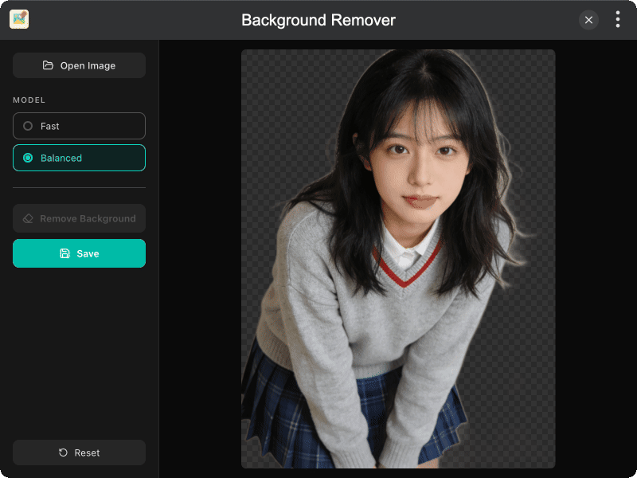

# tinker-bg-remover

A background removal plugin for [TINKER](https://github.com/liriliri/tinker), powered by [@imgly/background-removal](https://github.com/imgly/background-removal-js).

## Features

- **Local processing** — the model runs on your machine, no image is uploaded
- **Small & Medium** model sizes
- **Drag & drop** or file picker to load images
- **PNG export** for transparent results
- **Runs in TINKER and in the browser** — the same build works as a desktop plugin and as a web page

## Installation

Play directly in [browser](https://tinker.lirilili.io/plugins/bg-remover), or install via TINKER: download from `https://tinker.lirilili.io/`, then run `npm i -g tinker-bg-remover`.

## Usage

The segmentation model is not bundled with the plugin. It is fetched from the
imgly CDN on first use (about 84 MB for Small, 167 MB for Medium) and the
plugin shows download progress while it runs.

1. Open an image via drag & drop or the folder button
2. Select model size (Small or Medium)
3. Click "Remove Background"
4. Save the result as PNG
