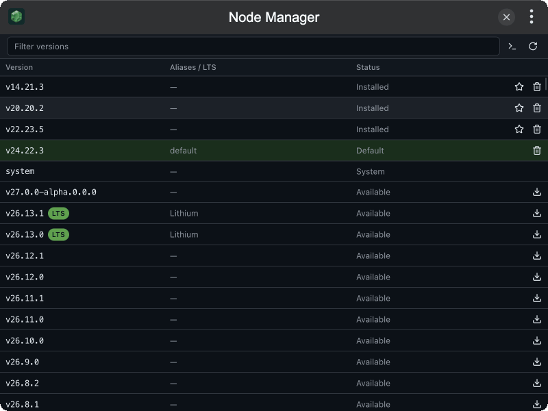

# tinker-node-manager

A Node.js version manager plugin for [TINKER](https://github.com/liriliri/tinker), powered by [fnm](https://github.com/Schniz/fnm) via `fnm-static`.

## Features

- **Browse versions** — merged list of installed and remote releases, installed first
- **Install / Uninstall** Node.js versions from each row
- **Set Default** — mark an installed version as fnm default (highlighted row)
- **Set up terminal** — write fnm shell init using the bundled binary (no separate fnm install)
- **Filter & refresh** the version list
- **MCP tools** `list_versions`, `list_remote_versions`, `install_version`, `uninstall_version`, and `set_default` for agent / CLI automation

## Installation

Download and install TINKER from `https://tinker.liriliri.io/`, then run `npm i -g tinker-node-manager`.

## Requirements

Versions are managed by the bundled fnm binary. Node installs live under fnm’s data directory (typically `~/.local/share/fnm`). For terminal `node` to follow the default version, use **Set up terminal** in the toolbar (links fnm under `~/.tinker/tinker-node-manager/bin` and writes init into your shell rc), then open a new terminal.

Shell targets: **zsh** → `~/.zshrc`, **bash** → `~/.bashrc`, **fish** → `~/.config/fish/config.fish`, **Windows** → PowerShell profile (`Documents/PowerShell/Microsoft.PowerShell_profile.ps1`, or Windows PowerShell’s profile if that is the one already present).

## Usage

1. Browse installed and remote Node.js versions in the table
2. Click **Install** on an available version, or **Uninstall** on an installed one
3. Click **Set Default** on an installed version (the current default is highlighted)
4. Use **Set up terminal** once so new shells pick up fnm
5. Filter by version, alias, or LTS name; refresh to reload remote releases
