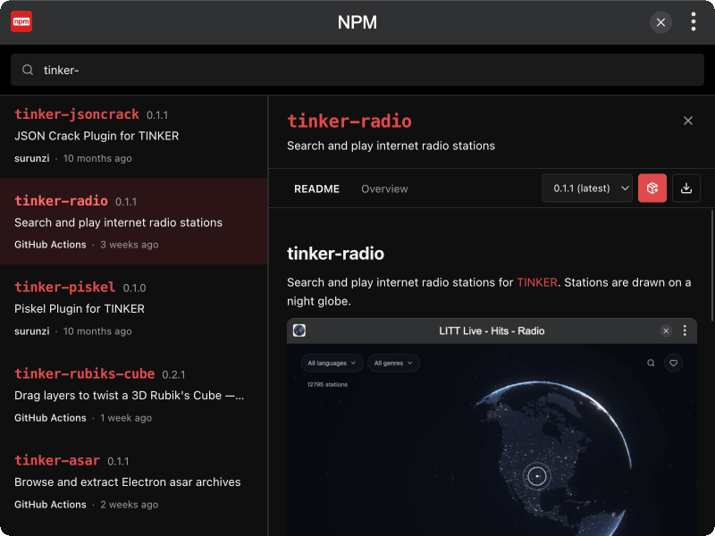

# tinker-npm

An npm registry browser plugin for [TINKER](https://github.com/liriliri/tinker), supporting package search, detail view, global install, and local tarball download.

## Features

- **Search** packages on the npm registry with live results
- **Package detail** — README, versions, dependencies, license, links, and size
- **Install globally** via local `npm install -g`
- **Download & extract** tarball to a chosen local folder
- **MCP tools** `search`, `get_package`, `install_global`, and `download` for agent / CLI automation

## Installation

Download and install TINKER from `https://tinker.liriliri.io/`, then run `npm i -g tinker-npm`.

## Usage

1. Search for a package name or keyword in the top bar
2. Select a result to open the detail sidebar (README / Overview)
3. Pick a version, then click **Install globally**, or **Download & extract** and choose a folder

## Data Source

Package metadata and search results come from the [npm registry](https://registry.npmjs.org/). Install and download use the local `npm` / `tar` tools on your machine.
