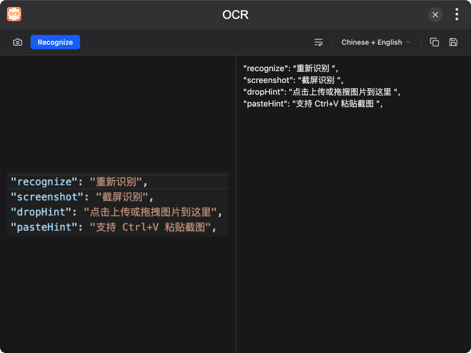

# tinker-ocr

An OCR plugin for [TINKER](https://github.com/liriliri/tinker), powered by ONNX PaddleOCR.

## Features

- **Image input** via file upload, drag & drop, paste, or screen capture
- **Chinese + English** recognition via PP-OCRv4
- **Strip newlines** option for cleaner output
- **Copy or save** recognized text

## Installation

Download and install TINKER from `https://tinker.liriliri.io/`, then run `npm i -g tinker-ocr`.

## Usage

1. Upload an image by clicking, dragging & dropping, pasting (Ctrl+V), or using the capture screen button
2. Click **Recognize** to extract text
3. Copy or save the result
