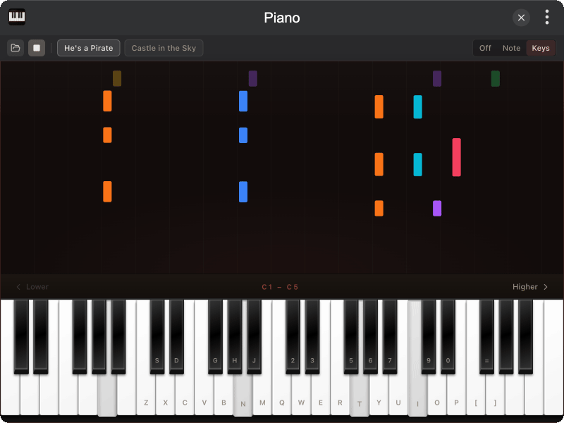

# tinker-piano

A virtual piano plugin for [TINKER](https://github.com/liriliri/tinker), with real grand piano samples, computer-keyboard play, and MIDI demos.

## Features

- **Playable keyboard** covering C1–C8 when the window is wide enough; fewer octaves when narrow
- **Computer keys** mapped to piano notes; arrow keys shift the octave range
- **Salamander samples** via Tone.js / `@tonejs/piano` for realistic note attack and release
- **Built-in demos**: He's a Pirate, Castle in the Sky
- **Open MIDI** from disk (or the browser file picker) and play it back
- **Key labels**: off, note names, or computer-key hints
- **Hold-length bursts** above the keys when notes are released

## Installation

Play directly in [browser](https://tinker.liriliri.io/plugins/piano), or install via TINKER: download from `https://tinker.liriliri.io/`, then run `npm i -g tinker-piano`.

## Usage

1. Wait for samples to load, then click keys or type on the keyboard to play
2. Use **Lower / Higher** (or ← / →) to move the visible octave range
3. Pick a demo song and press play, or open a `.mid` / `.midi` file
4. Switch label mode in the toolbar (Off / Note / Keys)

## Credits

Piano samples from the [Salamander Grand Piano](https://github.com/sfzinstruments/SalamanderGrandPiano) set, loaded through [`@tonejs/piano`](https://github.com/Tonejs/Piano).
