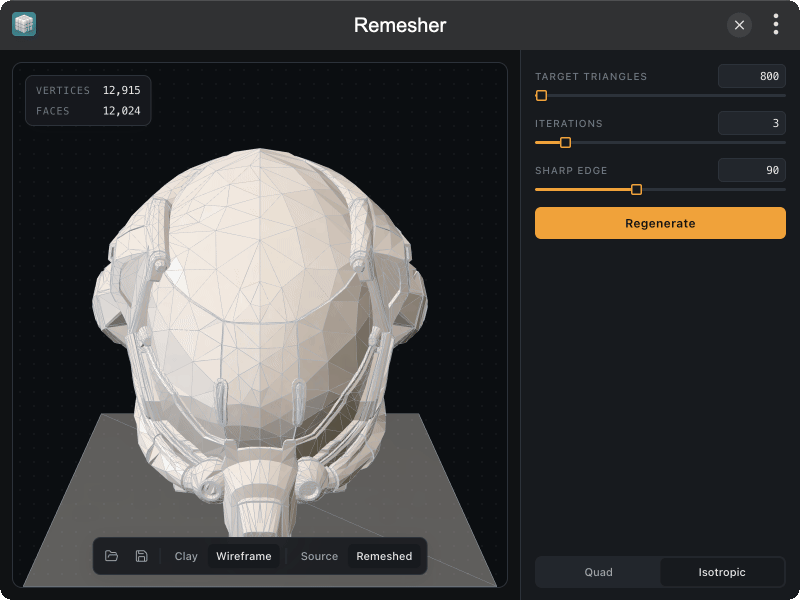

# tinker-remesher

A GLB remeshing plugin for [TINKER](https://github.com/liriliri/tinker), powered by [autoremesher](https://github.com/huxingyi/autoremesher) and [isotropicremesher](https://github.com/huxingyi/isotropicremesher).

## Features

- **Quad remeshing** with sharp-edge, smooth-normal, adaptivity, and anisotropy controls
- **Isotropic remeshing** with target triangle count and iteration settings
- **Drag & drop** or file picker to open `.glb` models
- **Original / remeshed** preview toggle with vertex and face counts
- **Clay and wireframe** display modes (white clay with flat wire overlay)
- **Save** remeshed output as `.glb`
- MCP tool `remesh` for agent / CLI automation

## Installation

Use directly in [browser](https://tinker.liriliri.io/plugins/remesher), or install via TINKER: download from `https://tinker.liriliri.io/`, then run `npm i -g tinker-remesher`.

## Usage

1. Drop or open a GLB model
2. Choose **Quad** or **Isotropic** mode and adjust parameters
3. Click **Regenerate** to remesh
4. Compare original vs remeshed, then save the result
