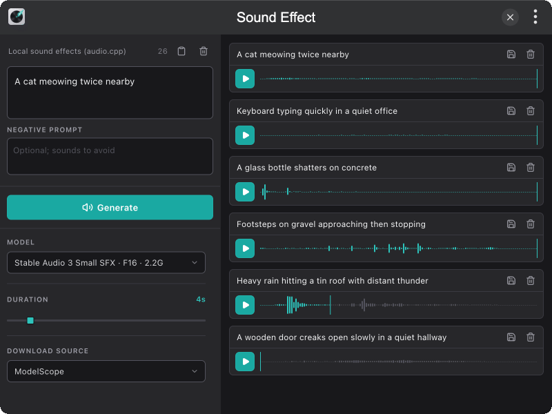

# tinker-sound-effect

A local text-to-sound-effect plugin for [TINKER](https://github.com/liriliri/tinker), powered by [audio.cpp](https://github.com/0xShug0/audio.cpp) via `audiocpp-static`.

## Features

- **Local SFX generation** with Stable Audio 3 Small SFX (Q8 / F16 GGUF)
- **English text prompts** with optional negative prompt
- **Duration control** (1–30s) for each generation
- **Auto model download** via Downloader into `~/.tinker/models/` when missing
- **Generation queue** with WaveSurfer preview, play, and save as WAV

## Installation

Download and install TINKER from `https://tinker.liriliri.io/`, then run `npm i -g tinker-sound-effect`.

## Usage

1. Describe a sound in English (e.g. “A wooden door creaks open slowly in a quiet hallway”)
2. Optionally set a negative prompt, duration, model, and download source
3. Click **Generate** — missing models start downloading automatically
4. Preview queued results in the audio list; save WAV when ready

Prompts work best in English. Runtime data lives in `~/.tinker/tinker-sound-effect/` (logs / outputs). Models are shared under `~/.tinker/models/`.
