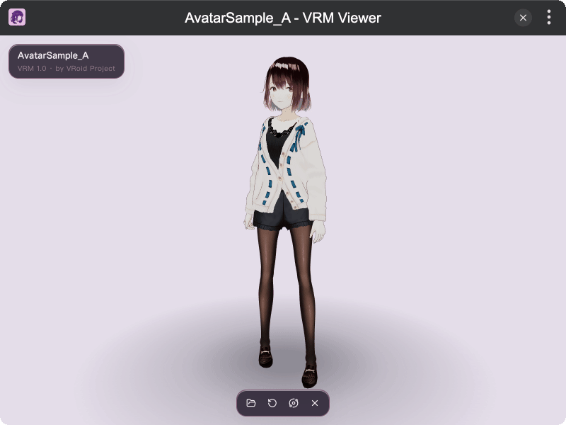

# tinker-vrm-viewer

A VRM avatar preview plugin for [TINKER](https://github.com/liriliri/tinker), powered by [three.js](https://threejs.org/) and [@pixiv/three-vrm](https://github.com/pixiv/three-vrm).

## Features

- **Open / drag & drop** `.vrm` models (VRM 0.x and 1.0)
- **Preset VRMA clips** — appear once on load, then loop idle / wait
- **Orbit controls** with camera reset and auto-rotate
- **Contact shadow** under the avatar
- **Model meta** (name, version, authors) when present

## Installation

Play directly in [browser](https://tinker.liriliri.io/plugins/vrm-viewer), or install via TINKER: download from `https://tinker.liriliri.io/`, then run `npm i -g tinker-vrm-viewer`.

## Usage

1. Drop a `.vrm` file onto the window, or click to open
2. Orbit with the mouse; scroll to zoom
3. Use the toolbar to reset the camera, toggle auto-rotate, open another file, or close
